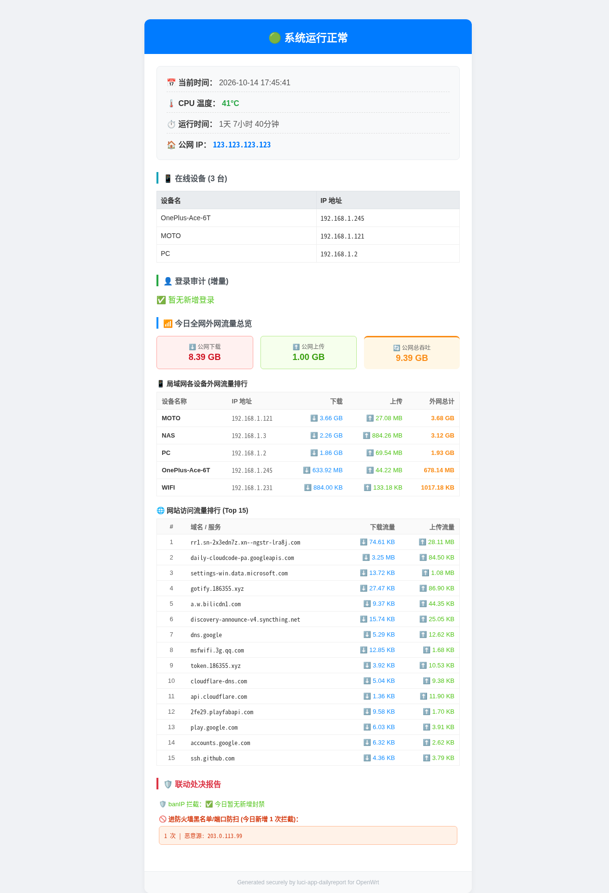
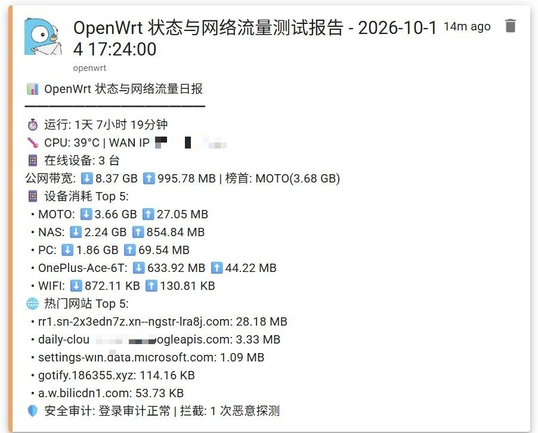

# luci-app-dailyreport

<p align="center">
  
  &nbsp;&nbsp;&nbsp;&nbsp;
  
</p>

<p align="center">
  <b>OpenWrt 智能系统状态与网络流量日报 LuCI 插件 (Daily Report, WAN Traffic & Security Audit for OpenWrt)</b>
  <br />
  <i>双轨物理流量对账 · 局域网各终端消耗排行 · 邮件 HTML 报表卡片 · Gotify 实时即时推送 · banIP / 防火墙安全联动 · 硬件超温防护</i>
</p>

<p align="center">
  <a href="#-功能特性">功能特性</a> •
  <a href="#-效果预览">效果预览</a> •
  <a href="#-安装说明">安装说明</a> •
  <a href="#-配置说明">配置说明</a> •
  <a href="#-更新日志-release-notes">更新日志</a> •
  <a href="#-english-documentation">English Docs</a> •
  <a href="#-许可证">开源协议</a>
</p>

<p align="center">
  
  
  
  
  
</p>

---

## ✨ 功能特性

- 📶 **双轨真实公网流量交叉对账**：
  - **物理 WAN 口独立增量**：从底层物理网口（如 `pppoe-wan` / `eth0`）独立计算每日物理真实字节消耗，作为运营商层面的权威参考。
  - **终端层精确统计**：基于 `nlbwmon` 彻底过滤局域网内部海量备份与无端口裸流，准确呈现各终端真实外网消耗。
  - 数据双轨并列呈现，杜绝虚假估算与大流量内网倒挂。
- 📱 **客户端公平与自愈统计**：
  - **认准物理 MAC**：以 MAC 作为唯一标识，彻底解决终端重连、休眠、DHCP 换 IP 导致的流量碎片化。
  - **新设备智能捕获**：自动发现访客或新增设备，自动解析 DHCP 主机名，动态建档。
  - **全网在线设备透视**：融合内核 ARP 邻居表（`ip neigh`）与静态绑定表，准确识别包括 NAS、静态服务器在内的在线状态。
- 🌐 **热门网站访问排行**：精准统计访问流量 Top 15 热门外部网站与域名。
- 🛡️ **安全审计与联动处决**：
  - 实时捕获 **banIP** 当日新增恶意 IP 封禁。
  - 联动 **nftables 防火墙** 捕获端口防扫（NAS-Port-Ban）动态黑名单增量。
- 🌡️ **硬件监控与高温保护**：实时采集 CPU 温度，支持超温（可自定义阈值，默认 75°C）邮件/Gotify 即时告警与可选 3 分钟倒计时保护关机。
- 📬 **双通道富文本推送**：
  - **邮件推送**：原生 Python `smtplib` 发送标准 HTML 响应式卡片报表（支持 SSL 465/587）。
  - **Gotify 即时推送**：即时 Markdown 格式通知，手机秒接收。
- 🌍 **双语界面与报表自适应**：Web 管理界面与外发报表（邮件/Gotify）全量支持 **简体中文** 与 **English**。
- 🧪 **一键测试**：后台支持「立即生成并发送日报」实时调试。

---

## 📸 效果预览

| 邮件 HTML 报表卡片 (Rich Email Card) | Gotify 实时即时推送 (Instant Alert) |
| :---: | :---: |
|  |  |

---

## 📦 安装说明

本插件采用纯脚本（JavaScript/Shell/Python3）架构，架构标识为 `all`，**全平台通用**（无论 x86_64、ARM64 还是 MIPS 等架构路由器均可直接安装使用）。

### 1. 下载预编译安装包

根据你固件所使用的包管理器选择对应格式：

#### 传统 `opkg` 环境 (OpenWrt 24.10, 23.05 及历史固件)
- 📦 **最新版 v1.5.0**: [点击下载 luci-app-dailyreport_1.5.0-1_all.ipk](https://raw.githubusercontent.com/sbitoh/luci-app-dailyreport/main/bin/packages/luci-app-dailyreport_1.5.0-1_all.ipk)
- 📦 **上一版 v1.4.0**: [点击下载 luci-app-dailyreport_1.4.0-1_all.ipk](https://raw.githubusercontent.com/sbitoh/luci-app-dailyreport/main/bin/packages/luci-app-dailyreport_1.4.0-1_all.ipk)
- 📦 **历史版 v1.3.2**: [点击下载 luci-app-dailyreport_1.3.2-1_all.ipk](https://raw.githubusercontent.com/sbitoh/luci-app-dailyreport/main/bin/packages/luci-app-dailyreport_1.3.2-1_all.ipk)
- 📦 **历史版 v1.3.1**: [点击下载 luci-app-dailyreport_1.3.1-1_all.ipk](https://raw.githubusercontent.com/sbitoh/luci-app-dailyreport/main/bin/packages/luci-app-dailyreport_1.3.1-1_all.ipk)
- 📦 **历史版 v1.3.0**: [点击下载 luci-app-dailyreport_1.3.0-1_all.ipk](https://raw.githubusercontent.com/sbitoh/luci-app-dailyreport/main/bin/packages/luci-app-dailyreport_1.3.0-1_all.ipk)
- 📦 **历史版 v1.2.0**: [点击下载 luci-app-dailyreport_1.2.0-1_all.ipk](https://raw.githubusercontent.com/sbitoh/luci-app-dailyreport/main/bin/packages/luci-app-dailyreport_1.2.0-1_all.ipk)
- 📦 **历史版 v1.1.0**: [点击下载 luci-app-dailyreport_1.1.0-1_all.ipk](https://raw.githubusercontent.com/sbitoh/luci-app-dailyreport/main/bin/packages/luci-app-dailyreport_1.1.0-1_all.ipk)
- 📦 **初始版 v1.0.0**: [点击下载 luci-app-dailyreport_1.0.0-1_all.ipk](https://raw.githubusercontent.com/sbitoh/luci-app-dailyreport/main/bin/packages/luci-app-dailyreport_1.0.0-1_all.ipk)

OpenWrt 终端一键安装：
```bash
wget -O /tmp/luci-app-dailyreport.ipk https://raw.githubusercontent.com/sbitoh/luci-app-dailyreport/main/bin/packages/luci-app-dailyreport_1.5.0-1_all.ipk
opkg install /tmp/luci-app-dailyreport.ipk
/etc/init.d/rpcd reload
```

#### 新版 `apk` (APK v3) 环境 (OpenWrt SNAPSHOT / 主线开发版)
- 🚀 **最新版 v1.5.0 APK**: [点击下载 luci-app-dailyreport-1.5.0-r1.apk](https://raw.githubusercontent.com/sbitoh/luci-app-dailyreport/main/bin/packages/luci-app-dailyreport-1.5.0-r1.apk)
- 🚀 **上一版 v1.4.0 APK**: [点击下载 luci-app-dailyreport-1.4.0-r1.apk](https://raw.githubusercontent.com/sbitoh/luci-app-dailyreport/main/bin/packages/luci-app-dailyreport-1.4.0-r1.apk)
- 🚀 **历史版 v1.3.2 APK**: [点击下载 luci-app-dailyreport-1.3.2-r1.apk](https://raw.githubusercontent.com/sbitoh/luci-app-dailyreport/main/bin/packages/luci-app-dailyreport-1.3.2-r1.apk)
- 🚀 **历史版 v1.3.1 APK**: [点击下载 luci-app-dailyreport-1.3.1-r1.apk](https://raw.githubusercontent.com/sbitoh/luci-app-dailyreport/main/bin/packages/luci-app-dailyreport-1.3.1-r1.apk)
- 🚀 **历史版 v1.3.0 APK**: [点击下载 luci-app-dailyreport-1.3.0-r1.apk](https://raw.githubusercontent.com/sbitoh/luci-app-dailyreport/main/bin/packages/luci-app-dailyreport-1.3.0-r1.apk)
- 🚀 **历史版 v1.2.0 APK**: [点击下载 luci-app-dailyreport-1.2.0-r1.apk](https://raw.githubusercontent.com/sbitoh/luci-app-dailyreport/main/bin/packages/luci-app-dailyreport-1.2.0-r1.apk)

OpenWrt 终端一键安装：
```bash
wget -O /tmp/luci-app-dailyreport.apk https://raw.githubusercontent.com/sbitoh/luci-app-dailyreport/main/bin/packages/luci-app-dailyreport-1.5.0-r1.apk
apk add --allow-untrusted /tmp/luci-app-dailyreport.apk
/etc/init.d/rpcd reload
```

---

## ⚙️ 配置说明

安装后进入 OpenWrt Web 界面：
**【服务】 -> 【系统与流量日报】** (Services -> System & Traffic Daily Report)

1. 开启日报服务并选择每日发送时间（如 `08:00`）。
2. 按需配置邮件推送（SMTP）或 Gotify 服务器凭据。
3. 点击 **保存并应用**，点击 **立即生成并发送日报** 即可立即测试。

---

## 📝 更新日志 (Release Notes)

### v1.5.0 (2026-10-26)
- **修复 PPPoE 宽带重拨导致 WAN 总量归零**：将底层公网流量接口优先绑定为真实的物理承载网卡（如 `eth1`），解决因运营商定时断线重拨导致虚拟接口 `pppoe-wan` 计数器清零、单日公网下载总量失真的问题。
- **双轨数据严丝合缝对齐**：确保宽带无论断线重拨多少次，全网公网吞吐与局域网各终端流量总和始终保持真实硬件级一致。

### v1.4.0 (2026-10-21)
* ⏱️ **48 小时环形快照池 + 24 小时动态滑动时间窗口（Sliding Window）**：
  - 彻底摒弃传统的固定 0 点强制重置基准模式，消除跨天统计盲区与数据丢失风险；
  - 引入后台每小时原子级快照持久化机制，自动保留最近 48 小时历史轮转切片；
  - 无论是每日定时自动发送还是用户主动点击“立即测试发送”，系统均统一精准提取“当前时刻往前倒推 24 小时”的同一笔快照作为起跑底数；
  - 测试发送与日常生成彻底转为纯只读提取，杜绝因手动测试打乱定时基准的问题；快照累积阶段具备平滑降级与跨度动态标注。
* 🔄 **三轨数据基准统一与闭环对账**：
  - 物理 WAN 口吞吐、局域网各终端外网流量、网站访问与目标公网 IP 排行三大数据源全部基于同一时刻的 24 小时快照底数计算净增量；
  - 从算法根源彻底解决因各轨数据统计时间窗口不一致导致的“网站流量超过 WAN 总流量”与数据倒挂现象。
* 🔍 **真实在线设备精准主动探测**：
  - 重构在线设备判定逻辑，采用局域网轻量主动网络探测（ping 响应）结合 UCI 静态绑定与 DHCP 动态主机名解析；
  - 彻底剔除因未到期的 DHCP 租约或过期的 ARP 缓存（FAILED 状态）造成的离线/关机设备被误判在线的顽疾。
* 📊 **统计周期内设备流量全景捕捉**：
  - 只要设备在过去 24 小时统计周期内产生过公网流量，无论当前处于在线还是离线状态，均如实呈现于终端流量排行榜中；
  - 自动净化周期内无外网流量（0 B）的静默设备，保持报表清爽整洁。
* 🚀 **全新内核级目标 IP 动态记账（杜绝短连接断开后流量蒸发）**：
  - 彻底重构底层网站与外网连接采集引擎，弃用易丢数据的 `/proc/net/nf_conntrack` 抽样轮询；
  - 接入 Linux 内核 `nftables` 动态计数器集合（`target_ip_rx` / `target_ip_tx`），不论大文件下载还是短连接传输，在连接关闭释放后仍 100% 永久留存字节数；
  - 深度兼容 OpenClash / 透明代理环境，完美捕捉 Fake-IP 真实吞吐，结合本地 DNS 解析日志精准还原回真实网站域名；
  - 引入 `target_ip_base.json` 每日 0 点起跑线基准，确保只统计当日真实净增量，与 WAN 物理总吞吐在同一数量级上严密对齐。
* 📱 **物理硬件设备精准归属与静默设备净化**：
  - 取消独立的“代理/系统分流”外挂卡片，所有公网总吞吐 100% 穿透落实到具体的物理终端硬件名下；
  - 未命名的局域网设备统一采用 `设备 [MAC]` 规范标识，表头统一为 `IP / MAC`；
  - 报表智能过滤统计周期内无流量（0 B）的静默/空闲设备，极大提升报表阅读体验。

### v1.3.1 (2026-10-19)
* 📱 **休眠与离线设备全景追踪（防止设备漏记）**：
  * 取消了此前大于 1KB 才记录设备的严苛过滤条件；
  * 联合基准设备列表、实时活跃列表与 DHCP 静态分配列表，确保即使设备关机、休眠或离线（增量为 0 B），也完整呈现在报表中并标记为 `(待机/离线)`，彻底消除“设备断线后从报表消失”的困惑。
* 🌐 **代理回环与系统出网分流差额透明化**：
  * 新增 **【代理/路由系统分流】** 卡片，精确展示物理 WAN 吞吐与终端直连聚合之间的差额；
  * 完美解释因 OpenClash 透明代理（127.0.0.1 重定向回环）、路由器自身更新、DNS 等产生的流量流向，报表数据 100% 严密对齐。

### v1.3.0 (2026-10-16)
* 📶 **双轨真实流量交叉验证与对账**：
  * **物理层独立增量**：从底层网口（如 `pppoe-wan`）独立捕获每日物理字节消耗，作为运营商层面的权威参考；
  * **终端层精确聚合**：基于 `nlbwmon` 过滤端口与内网大备份，精确统计各终端外网增量；
  * 报表以“物理 WAN 真实吞吐 + 终端统计总和”并列呈现，数据严密闭环，彻底告别虚假估算。
* ⏱️ **0 点原子级跨天起跑线快照**：
  * 新增 0 点跨天基准原子落盘机制（`nlbw_base.json` 与 `wan_base.json` 同时锁定），彻底解决凌晨 0 点到发信前流量被漏计的盲区。
* 🌐 **DNS 缓存按日轮转与日志清理**：
  * 跨天自动清零 DNS 缓存记录（`/root/dns_cache.log`），防止历史解析长期驻留污染次日热门域名统计；
  * 移除已废弃的旧版残留逻辑，提升代码鲁棒性。

### v1.2.0 (2026-10-15)
* 🚀 **正式支持 OpenWrt 官方下一代 `apk` (APK v3) 包管理**：
  * 构建了原生的 `.apk` 安装包（`luci-app-dailyreport-1.2.0-r1.apk`），支持在 OpenWrt SNAPSHOT / 主线新固件上一键 `apk add` 安装。
  * 保持双格式同步发布：传统固件使用 `.ipk`（`opkg`），新固件使用 `.apk`（`apk`）。
* 📦 **版本归档机制健全**：GitHub Releases 与 `bin/packages/` 中完整保留所有历史版本资源（v1.0.0、v1.1.0、v1.2.0），绝不覆盖历史文件。
* ⏱️ **修复英文模式下运行时长 (Uptime) 显示**：补齐英文版邮件与 Gotify 推送中缺少的系统运行时长数据。

### v1.1.0 (2026-10-15)
* 🌐 **新增顶部中英文显式切换**：在 Web 基本设置最顶部加入语言选择，界面与推送报表（HTML 邮件与 Gotify 推送）全自适应中英文双语。
* 💾 **安装与升级配置持久化保护**：注入 `conffiles` 保护协议，再次安装或升级版本时自动保留现有邮箱凭据与推送配置，杜绝被空模板覆盖。
* 📱 **局域网设备统计架构重构**：
  * **唯一身份认准物理 MAC**：解决终端断开重连、多次上线、或者更换 IP 造成的重复计算与流量碎片化。
  * **新设备智能捕获与自愈命名**：支持新接入终端（访客 WiFi、新设备）即时自动建档，自动解析 DHCP 主机名并优雅兜底。
  * **在线设备全面识别**：融合系统内核 ARP 邻居（`ip neigh`）与静态绑定表，完整识别 NAS 及静态 IP 主机在线状态。
* 📶 **全网流量闭环约束与防倒挂**：
  * 引入物理 WAN 口硬顶约束，确保设备排行总计与公网总吞吐严格收敛，彻底杜绝 NAS 等大流量设备数据倒挂。
  * 新增跨天（0点）自动清零守护，解决多天跨度累积导致的流量虚高问题。
  * 增强 Flash 快照定时落盘，提供路由器意外重启后的抗损恢复能力。

---

<br />

# 🌐 English Documentation

OpenWrt Intelligent System Health, WAN Traffic & Security Audit Daily Report LuCI Application.

## ✨ Features
- 📶 **Dual-Track Real WAN Traffic Reconciliation**: Accurately cross-verifies physical interface byte counters (`pppoe-wan`) against client-level `nlbwmon` accounting to eliminate LAN backup skews.
- 📱 **Client Breakdown**: Fair and universal accounting for all LAN devices (NAS, phones, PCs, and dynamically detected new devices).
- 🌐 **Top 15 Visited Websites**: Identifies and ranks top bandwidth-consuming external domains.
- 🛡️ **Security Audit & Execution Report**: Real-time tracking of new daily **banIP** blocklist drops and **nftables firewall** port-scan defenses.
- 🌡️ **Hardware Health & Overheat Protection**: CPU temperature tracking with alerts and optional safe shutdown.
- 📬 **Dual-Channel Rich Notifications**: Formatted HTML email cards via standard SMTP and instant Gotify push alerts.

---

## 📄 许可证 (License)

Licensed under the [Apache License 2.0](LICENSE).

Developed with precision by **sbitoh**.
